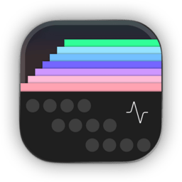

<div align="center">



# Futureboard Studio

**A native digital audio workstation with instruments and effects.**

[](https://snapcraft.io/futureboard-studio)
[](https://snapcraft.io/core26)

[](https://snapcraft.io/publisher/sidaliteir)


[Getting Started](#getting-started) · [Configure](#configure) · [Limitations](#limitations) · [Build](#build) · [Support](#support) · [License](#license)

Unofficial snap packaging for [Futureboard Studio](https://github.com/futureboard/futureboard-studio), a native DAW for recording, arranging, editing and mixing audio and MIDI.

</div>

---

## Getting Started

<a href="https://snapcraft.io/futureboard-studio"></a>

```bash
sudo snap install futureboard-studio
sudo snap connect futureboard-studio:audio-record
futureboard-studio
```

Launch from the terminal or application menu. Built-in instruments, effects, their editors and the stem extraction runtime are included. Upstream is in early development; keep backups of your projects.

## Configure

Choose audio devices, MIDI devices, sample libraries and plugin folders in the app. There are no `snap set` options. Desktop audio uses your sound server by default.

| Optional access | Command |
| --- | --- |
| Direct audio and MIDI hardware | `sudo snap connect futureboard-studio:alsa` |
| Projects and samples on removable storage | `sudo snap connect futureboard-studio:removable-media` |

Place additional Linux plugins in a visible folder such as `~/Music/Plugins` and add it to the plugin scan paths. Stem extraction models are downloaded separately through the app.

## Limitations

- amd64 only: upstream's Linux embedded plugin editor runtime does not support ARM64 yet.
- System-installed plugins and plugins requiring host-only libraries or services are unavailable. Use the included instruments/effects or compatible plugins in accessible folders.
- The separate APAK package installer is not included because upstream's production verification key is not public. Plugin signature verification is not bypassed.
- Updates are managed by snapd; the in-app updater is disabled.

## Build

Packaging draft: automated builds and dependency updates are deferred.

```bash
git clone https://github.com/sidalit/futureboard-studio-snap.git
cd futureboard-studio-snap
sudo snap install snapcraft --classic
snapcraft pack
```

## Support

- **Installation or snap issues:** [open a packaging issue](https://github.com/sidalit/futureboard-studio-snap/issues).
- **Application bugs:** [report them upstream](https://github.com/futureboard/futureboard-studio/issues).

## License

Snap packaging: [MIT](https://github.com/sidalit/futureboard-studio-snap/blob/main/LICENSE).
